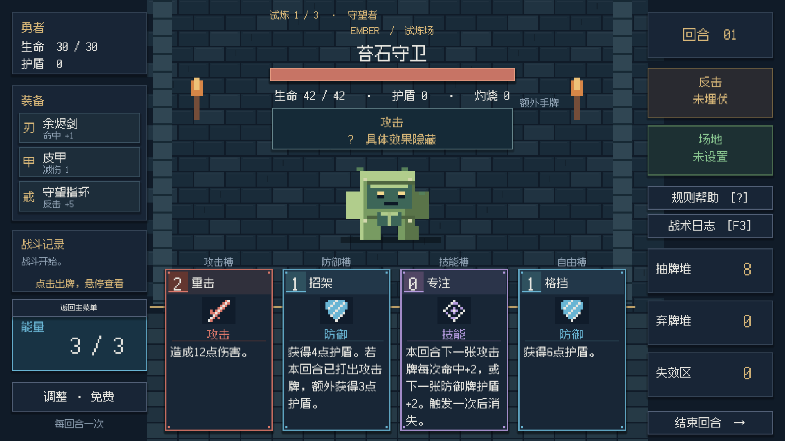
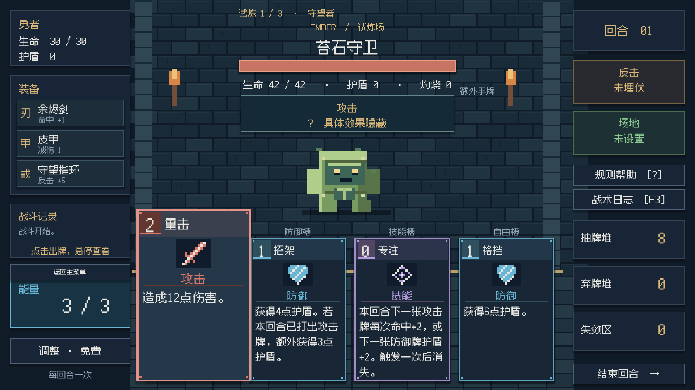

# 余烬试炼 · Ember Trials

[演示视频（75 秒）](https://github.com/Cheng-Jimmy/Ember-Trials/releases/download/v1.0.0/ember_demo_75s.mp4) · [Windows 试玩版](https://github.com/Cheng-Jimmy/Ember-Trials/releases/download/v1.0.0/ember_visual_windows.zip) · [源代码](https://github.com/Cheng-Jimmy/Ember-Trials) · [版本与附件](https://github.com/Cheng-Jimmy/Ember-Trials/releases/tag/v1.0.0)

一款围绕**有限能量、分类抽牌与跨战构筑**展开的短流程策略卡牌原型。玩家选择防守反击或多段灼烧路线，连续挑战三名敌人，在两次战后奖励中选择卡牌和装备，最终结算后可返回主菜单重新开始。

## 玩法与策略决策

| 系统 | 玩家需要作出的选择 |
| --- | --- |
| 每回合 3 点能量 | 在伤害、防御与状态积累之间分配行动预算 |
| 分类抽牌与自由牌 | 利用类别槽保障基础行动；用自由槽补足当前回合需要 |
| 手牌保留、免费调整、弃牌循环 | 规划下一回合资源与关键牌的再出现时机 |
| 敌人行动意图与主动反击 | 根据攻击方式安排格挡与反击时机 |
| 装备槽位与场地 | 在逐段收益、护盾和持续效果之间取舍；同槽装备替换 |
| 三战与两次奖励 | 在后续敌人压力下决定选卡、装备和构筑方向 |

**防守反击**路线通过护盾、盾击、格挡与反击把防御转换为输出；**多段灼烧**路线通过连续攻击、逐段装备收益和持续伤害累积优势。扩展包含八张新卡，分别承担护盾收益、反击准备、场地防御、多段攻击、灼烧积累等用途。

三名敌人为苔石守卫、灰烬游侠与熔炉之王，分别突出护盾／净化、多段攻击和蓄力重击。战后获得一张卡与一件装备，选择会进入后续实际牌组与装备配置。

## 操作与启动

- 鼠标点击卡牌、抽牌分类与操作按钮；悬停查看卡牌、装备说明。
- 点击结束回合并在敌人攻击窗口使用反击；界面帮助说明保留与免费调整规则。
- `?` / `/` 打开帮助，`Esc` 关闭帮助或取消当前操作，`F3` 查看战术日志。
- Windows：下载并完整解压试玩 ZIP，运行 `StartGame.cmd`。包内引擎与 `game.pck` 必须保留在同一目录。
- 源工程：Godot **4.7.2** 导入仓库根目录 `project.godot`，等待资源导入，按 `F6` 运行 `scenes/campaign.tscn` 或按 `F5` 运行主场景。工程内部保留原配置名称 `pokegame`。

## 系统实现与迭代

技术栈：Godot 4.7.2、GDScript、Resource 配置、程序像素绘制与合成音效。`CardData` 与 `CardInstance` 分离配置和实例状态；`BattleManager` 管理显式回合阶段与统一伤害流程；`CampaignUI` 管理三战与奖励。敌人、初始牌组、装备通过资源配置，资源校验与确定性随机机制支持回归与策略模拟。

视觉迭代将生命／意图、卡牌决策和装备信息按阅读顺序组织，增加悬停预览与伤害、护盾、灼烧、反击反馈。动画只承担显示，避免阻挡出牌和回合操作。

## 验证与展示范围

2026-10-10 已有验收包括旧规则 15,985 次断言、扩展效果 14 项、三战流程 874 次检查、真实 UI 三战流程 105 项与视觉交互 139 项；界面覆盖 1280×720、1600×900、1920×1080。详细记录见 [tests](tests/) 和 [发布验证](docs/PUBLISH_CHECKS.md)。自动化策略模拟使用可见意图和固定策略，属于工程验证，不能解释为用户测试或玩家胜率。

视频来自真实游戏渲染与自动化点击，包含菜单、三场战斗、两次奖励和最终结算；未改生命或强制胜利。未进行跨设备性能评测。Windows 试玩为官方完整引擎＋资源包的便携演示版本，非精简导出模板构建。

## 开发背景与贡献

个人 Godot 原型，**2026 年 9 月初开始开发**，用于游戏策划／游戏开发校招作品集。原型及既有规则由作者提供；扩展目标、两条构筑方向与验收要求由作者提出。后续实现、程序视觉／音效、自动化测试、调整与打包使用 Codex 辅助完成。贡献归属保留于 [PORTFOLIO.md](PORTFOLIO.md)，不将辅助生成的实现描述为本人独立手写。

[主菜单截图](docs/screenshots/menu.png) · [资源来源与许可](ASSET_LICENSES.md)
